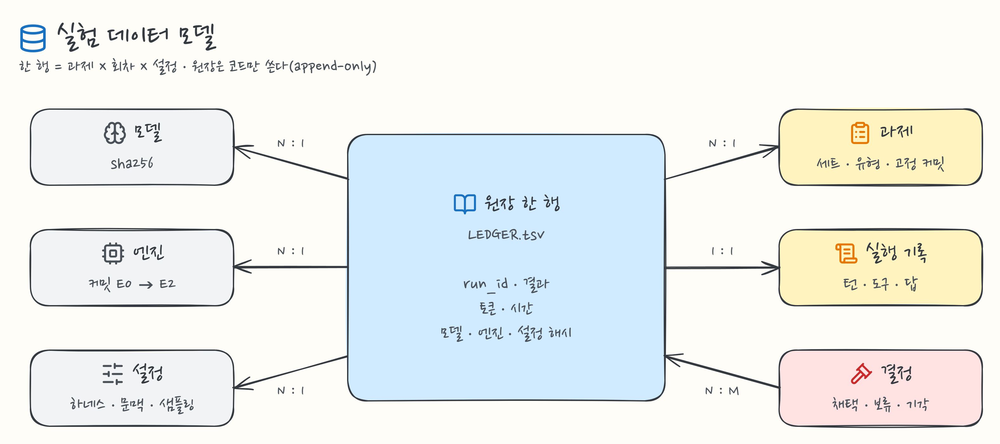
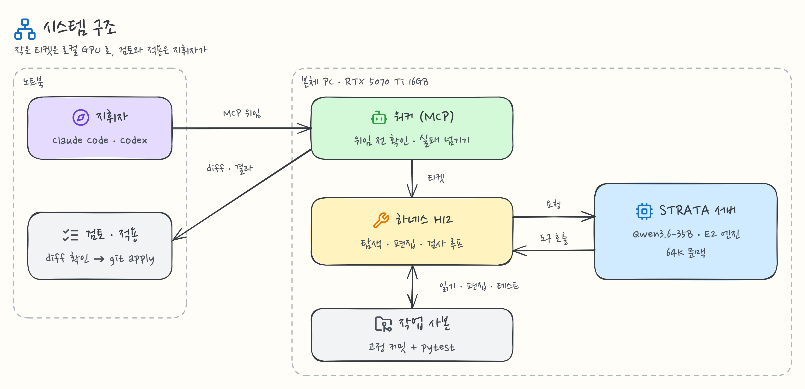
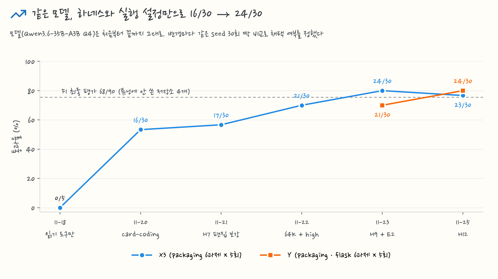
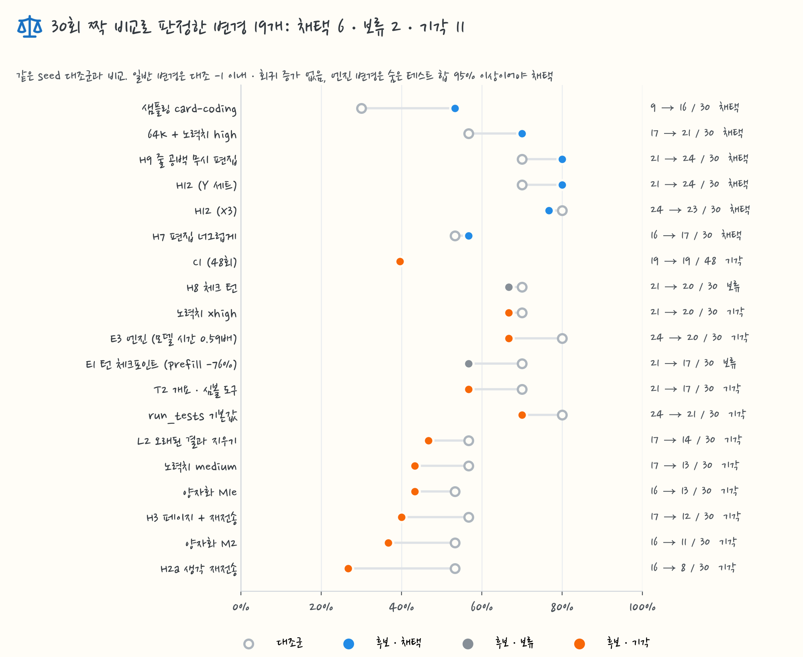
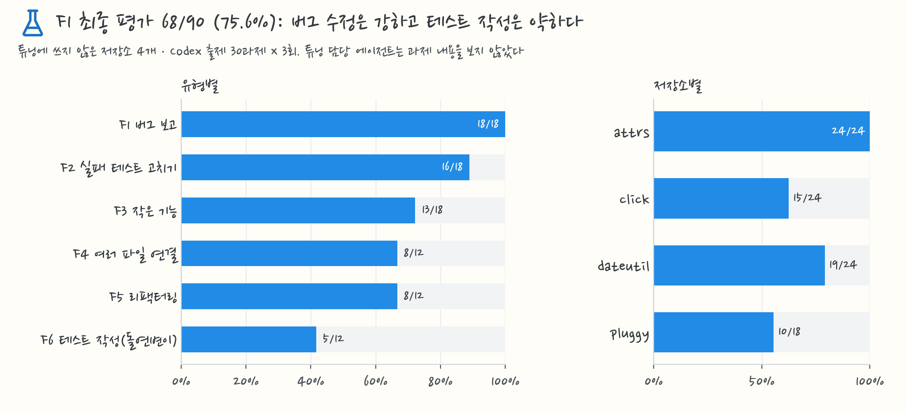
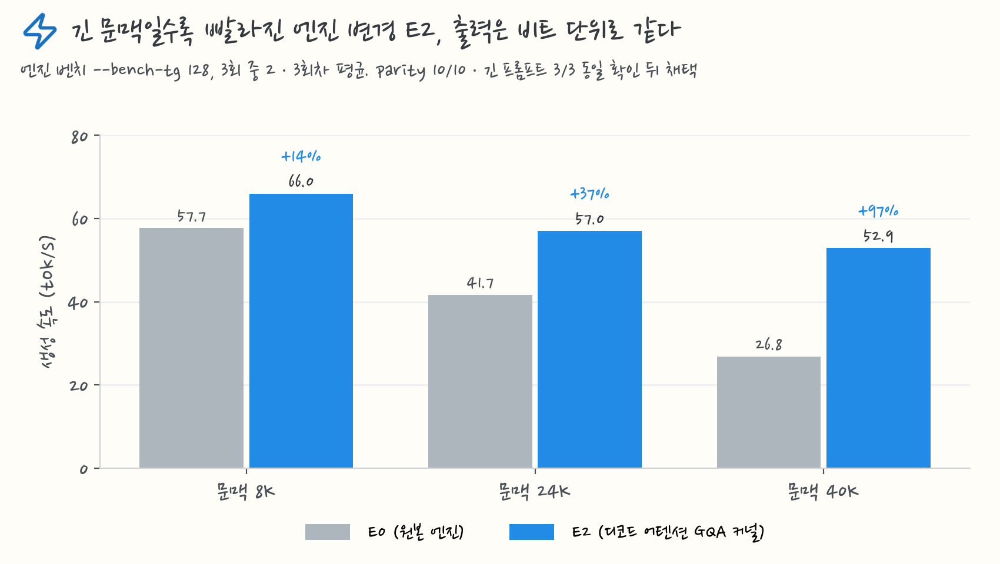
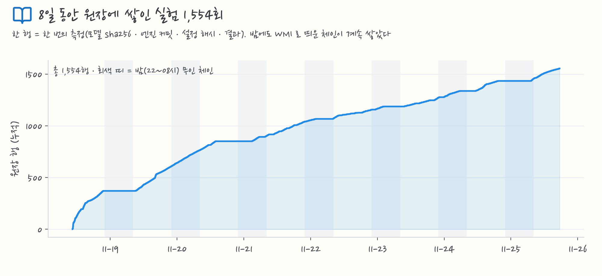
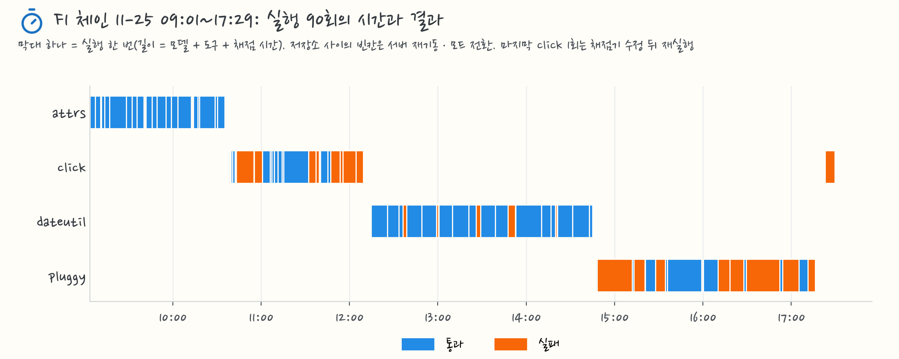

# strata-local-llm

**GPU 한 장(RTX 5070 Ti 16GB)에서 돌리는 35B 로컬 코딩 워커 — 하네스 · 엔진 · 양자화를 30회 짝 비교로 고르고, 튜닝과 분리한 30과제로 최종 평가**

> 상세 설명은 [위키](https://github.com/jinsan02/strata-local-llm/wiki)에 있다. 현재 상태와 결정 기록은 [`STATE.md`](STATE.md), 최종 보고서는 [위키 · 최종 보고서](https://github.com/jinsan02/strata-local-llm/wiki/최종-보고서).

---

##  1. 팀 소개

1인 프로젝트. 사람이 목표 · 판정 규칙 · 채택 결정을 맡고, AI 에이전트 둘에게 역할을 나눠 맡겼다. 두 에이전트는 서로의 산출물을 보지 않게 분리했다(최종 평가 출제자와 튜닝 담당).

|  |  |  |
| :---: | :---: | :---: |
| [**jinsan02**](https://github.com/jinsan02) | **Claude Code** | **Codex** |
| 목표 · 판정 규칙 설계, 채택 결정, 운영 승인 | 하네스 · 엔진 패치 구현, 측정 체인 운영, 기록 | 최종 평가 F1 출제(30과제), 검증 실패 과제 수정 |

##  2. 프로젝트 개요

| 항목 | 내용 |
| --- | --- |
| 프로젝트명 | **strata-local-llm** — 단일 소비자 GPU 위의 로컬 코딩 워커 |
| 한 줄 소개 | Qwen3.6-35B-A3B 를 [STRATA](https://github.com/Niko1221/Strata) 엔진으로 16GB GPU 에 올리고, 클라우드 에이전트가 작은 코딩 작업을 넘기면 파일 탐색 → 수정 → 테스트까지 하고 diff 를 돌려주는 워커를 만든다 |
| 필요성 (배경) | 로컬 LLM 튜닝 글은 많지만 대부분 몇 번 돌려 본 인상이나 처리량 숫자에서 끝난다. 같은 설정도 실행마다 결과가 흔들려서(30회 중 ±4회), 작은 표본으로는 좋아진 건지 우연인지 가릴 수 없다. 또 튜닝에 쓴 과제로 성능을 말하면 과적합을 걸러낼 수 없다. 그래서 **모든 측정을 재현 가능한 데이터(원장)로 남기고, 미리 정한 규칙으로만 판정하는 실험 체계**가 먼저 필요했다 |
| 목표 | ① 정확도 우선: 정확도가 떨어지는 변경은 빨라도 버린다 ② 판정 근거가 되는 데이터: 모든 실행을 모델 · 엔진 · 설정 해시와 함께 원장 1행으로 ③ 튜닝과 분리된 최종 평가로 실제 실력 보고 |

##  3. 기술 스택

| 영역 | 기술 | 쓰임 |
| --- | --- | --- |
| **모델** |   | 35B MoE(활성 3B), 4비트 혼합 양자화 22.9GB |
| **추론 엔진** |    | 소스 빌드(sm_120), 디코드 어텐션 커널 패치 E2 |
| **양자화** |  | BF16 → Q8_0 → imatrix → 맞춤 후보 4개(탈락) |
| **하네스 · 평가** |    | navigate 루프 · 숨은 테스트 · 돌연변이 채점 |
| **워커 연동** |    | 지휘자 → 로컬 워커 위임, F1 출제 |
| **운영** |     | 무인 밤 체인(WMI) · 측정/사용자 모드 전환 |
| **기록 · 재현** |   | 원장 · 커밋 트레일러 검사 · 기록/코드 분리 |
| **시각화** |     | 차트 · 손그림 구조도 · 아이콘 · 글꼴 (Tiny Lab 톤) |

| 장비 · 설정 | 값 |
| --- | --- |
| GPU · RAM | RTX 5070 Ti 16GB (sm_120) · RAM 32GB, 운영 중 VRAM 15.1GB · 남은 RAM 0.6~1.2GB |
| 운영 설정 | M0 `UD-Q4_K_XL` · 엔진 E2 · 64K 문맥 · 노력치 high · 하네스 H12 · 샘플링 card-coding |

##  4. WBS

8일, 커밋 230개(커밋 메시지 규칙상 `record` = 측정 기록, `feat` = 기능, `docs` = 문서). 날짜별 상세는 [위키 · WBS](https://github.com/jinsan02/strata-local-llm/wiki/WBS).

| 날짜 | 단계 | 주요 작업 | 커밋 |
| --- | --- | --- | ---: |
| 11-18 | 환경 · 기준선 | conda 환경 · 엔진 소스 빌드 · 모델 확보, 처리량 X0~X2, 출력 예산 XB, 하네스 첫 버전(0/5 → 4/5) | 82 |
| 11-19 | 하네스 탐색 | H0~H4 · C1 A/B, 30회 확인 규칙 확정, 무인 밤 체인(WMI) | 22 |
| 11-20 | 샘플링 · 양자화 준비 | card-coding 채택(9 → 16/30), BF16 · imatrix 보정 세트 | 19 |
| 11-21 | 양자화 · 편집 보강 | Q1 후보 4개 탈락 → M0 유지, H7 채택 | 37 |
| 11-22 | 문맥 · 엔진 | 64K + 노력치 high(21/30), 엔진 턴 체크포인트 E1(보류), 저장소 공개 | 21 |
| 11-23 | 엔진 · 새 세트 | E2 커널 채택(디코드 최대 +97%), H9 채택(24/30), Y 세트 | 23 |
| 11-24 | 실사용 · 출제 | X4 실제 클라이언트, E3 판정, F1 30과제 출제 · 검증, 워커 위임 규칙 | 19 |
| 11-25 | 최종 평가 | H12 채택, F1 90회(68/90), 채점기 수정 · 재실행, 보고서 | 7 |

##  5. 요구사항 명세

관점별 요구사항과 판정 기준. 상세(근거 · 측정 방법)는 [위키 · 요구사항 명세](https://github.com/jinsan02/strata-local-llm/wiki/요구사항-명세).

| ID | 관점 | 요구사항 | 판정 기준 | 결과 |
| --- | --- | --- | --- | --- |
| R1 | 사용자 | 클라우드 에이전트가 작은 코딩 작업을 로컬 워커에 넘기고 diff · 테스트 결과를 받는다 | MCP 도구 한 번 호출로 끝까지 | 완료 (`delegate_code_task`) |
| R2 | 정확도 | 정확도가 떨어지는 변경은 채택하지 않는다 | 같은 seed 30회 짝 비교, 대조 −1 이내 · 회귀 증가 없음 | 변경 19개 판정(채택 6 · 보류 2 · 기각 11) |
| R3 | 데이터 | 모든 측정은 재현 가능한 원장 1행으로 남긴다 | 모델 sha256 · 엔진 커밋 · 설정 해시 · 결과, 커밋 훅이 검사 | 원장 1,554행 |
| R4 | 평가 분리 | 최종 평가는 튜닝과 분리된 과제로 한 번 | 튜닝에 안 쓴 저장소, 다른 에이전트 출제, 튜닝 담당은 내용 비공개 | F1 68/90 |
| R5 | 자원 | 16GB VRAM · 32GB RAM 에서 64K 문맥 운영 | OOM 없음, 서버 기동 · 응답 | VRAM 15.1GB · RAM 여유 0.6~1.2GB |
| R6 | 엔진 | 엔진 변경은 출력이 같거나(손실 없음) 품질 관문 통과 | parity 비교 · 숨은 테스트 합 95% 이상 | E2 채택, E1 · E3 보류 · 미채택 |
| R7 | 보안 | 모델 셸은 인터넷 · 임의 인터프리터 금지, 서버는 루프백 + API 키 | 허용 목록 · 프록시 · 실행 기록 감사 | 위반 1건 감사로 적발 · 무효 처리 |

##  6. 실험 데이터 모델 (ERD)



원장 한 행 = 한 과제 × 한 회차 × 한 설정. 설명은 [위키 · 실험 데이터 모델](https://github.com/jinsan02/strata-local-llm/wiki/실험-데이터-모델).

##  7. 주요 프로시저



측정 한 회가 과제에서 원장 · 판정까지 가는 데이터 흐름은 [위키 · 데이터 흐름](https://github.com/jinsan02/strata-local-llm/wiki/데이터-흐름), 최종 평가의 분리 구조는 [위키 · 평가 설계](https://github.com/jinsan02/strata-local-llm/wiki/평가-설계). 그림 원본(`.excalidraw`)은 [`reports/figures/diagrams/`](reports/figures/diagrams/)에 있어 [excalidraw.com](https://excalidraw.com) 에서 열어 고칠 수 있다.

##  8. 수행 결과

###  8-1. 같은 모델로 16/30 → 24/30



모델 파일은 처음부터 끝까지 그대로다. 실패 로그를 유형별로 세어 원인을 좁히고(편집 적용 실패 · 도구 호출 수 부족), 원래 실패할 경우에만 동작하는 보정을 넣었다. 점선은 튜닝에 쓰지 않은 저장소로 잰 최종 평가(68/90)다.

###  8-2. 30회 짝 비교로 판정한 변경 19개



빈 원 = 같은 seed 의 대조군, 색 점 = 후보. 15회 · 9회 탐색에서 좋아 보였던 후보가 30회에서 뒤집힌 일이 세 번 있어서, 판정은 30회 짝 비교와 미리 정한 문턱으로만 했다. 속도 이득이 확실한 엔진 변경(E1 · E3)도 품질 관문을 못 넘어 쓰지 않았다.

###  8-3. 최종 평가 F1: 68/90 (75.6%)



튜닝에 쓰지 않은 저장소 4개(attrs · click · dateutil · pluggy)에서 Codex 가 30과제를 만들고, 검증기(기준 실패 · 참조 통과 · 두 번 같은 결과 등)를 통과한 것만 3회씩 돌렸다. 버그 보고 · 실패 테스트 고치기는 34/36, 테스트 작성은 5/12. 이 결과로 워커에 넘길 일과 넘기지 않을 일을 나눴다. 상세는 [위키 · F1 최종 평가](https://github.com/jinsan02/strata-local-llm/wiki/F1-최종-평가).

###  8-4. 엔진 변경 E2: 긴 문맥 생성 속도 최대 2배



디코드 어텐션을 GQA 커널로 바꾼 변경. 출력이 원본 엔진과 비트 단위로 같음을 확인(parity 10/10, 긴 프롬프트 3/3)한 뒤 품질 재측정 없이 채택했다.

###  8-5. 측정 운영 화면



8일 동안 원장에 쌓인 측정 1,554회. 회색 띠(밤)에도 WMI 로 띄운 체인이 계속 돌았다. 측정 중에는 추적 경로를 건드리지 않고, 끝나면 측정 모드에서 사용자 모드로 자동 전환한다.



F1 체인 하루(09:01~17:29)의 실행 90회. 막대 하나가 실행 한 번이고 색은 통과(파랑) · 실패(주황)다. 저장소 사이 빈칸은 서버 재기동이다. 마지막 click 1회는 채점기가 UTF-8 이 아닌 출력에서 죽어 기록이 빠진 것을 고친 뒤 같은 seed 로 다시 돌린 것이다.

체인 로그 일부(과제 내용 없이 진행 · 자원 상태만 찍는다):

```text
[f1] start 2026-11-25T09:01:26 commit 9b2e80d engine E2 reps 3 h10 True h11 True
[f1] attrs 과제 8개
[g3] harness H12 prefix f1 edit-apply lenient ctx 65536 effort high h9 True task-set final-attrs h10 True h11 True
[g3] M0 loaded=True load_s=68 slots=42 vram_mib=15071 free_ram_gb=1.24
[g3] M0 rep 1 2026-11-25T09:03:45
[g3] M0 rep 1 end 2026-11-25T09:35:39
...
[f1] attrs end 2026-11-25T10:35:31
[f1] click 과제 8개
[g3] M0 loaded=True load_s=62 slots=42 vram_mib=15071 free_ram_gb=0.95
```

##  9. 한 줄 회고

> 모델을 바꾸지 않아도 하네스와 판정 규칙만으로 통과율이 16/30 → 24/30 이 됐다. 가장 많이 배운 것은 '좋아 보인다'를 믿지 않는 법 — 15회에서 좋던 후보가 30회에서 세 번 뒤집혔고, 그래서 규칙을 측정 전에 정했다.

---

<details>
<summary><b>저장소 구조 · 규칙</b></summary>

| 경로 | 내용 |
| --- | --- |
| [`STATE.md`](STATE.md) | 현재 위치 · 결정 기록 |
| [`experiments/LEDGER.tsv`](experiments/LEDGER.tsv) | 원장 (append-only, 스키마 [`docs/LEDGER_SCHEMA.md`](docs/LEDGER_SCHEMA.md)) |
| [`scripts/bench/`](scripts/bench/) | 하네스 `run_x3.py` · 체인 · 자체 점검 |
| [`scripts/worker/`](scripts/worker/) | MCP 워커 |
| [`docs/`](docs/) | 실험별 설계 · 결과, [`TROUBLESHOOTING.md`](docs/TROUBLESHOOTING.md) |
| [`reports/`](reports/) | 요약 · 그림 (`figures/plots.py` · `plots2.py` 로 다시 그림) |

규칙 본문은 [`docs/RULES.md`](docs/RULES.md) 한 곳에만 있다. 측정 기준 · 채점기 · 기준선을 바꿔서 수치를 올리지 않는다. 결과는 원장에 코드가 쓰고 `record` 커밋에 코드를 섞지 않는다. 비밀값과 최종 평가 과제는 커밋하지 않는다.
</details>
