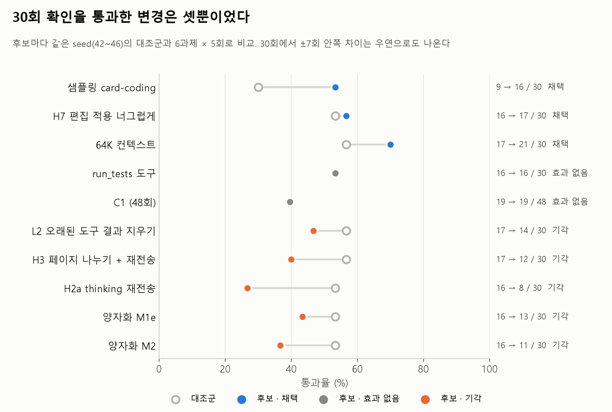

# strata-local-llm

**STRATA Inference Optimization on a Single RTX 5070 Ti 16GB**

단일 RTX 5070 Ti 16GB · RAM 32GB 본체에서 [Niko1221/Strata](https://github.com/Niko1221/Strata) 로 35B MoE 모델을 돌리고,
노트북의 코딩 도구(Claude Code · Codex)가 원격으로 불러 **파일 탐색 → 수정 → 테스트 → 실패 로그로 재수정** 을 맡길 수 있는
로컬 코딩 에이전트를 만드는 실험. 실행 설정 · 하네스 · 레이어별 양자화 · 엔진 코드를 바꿔 보고, 정확도를 지키는 변경만 남긴다.

> **2026-11-22 기준.** 하네스 · 샘플링 · 양자화 탐색을 마쳤고, 엔진 패치(E1)와 도구 개선을 준비 중이다.
> 한 장 요약은 [`reports/progress-20261122.md`](reports/progress-20261122.md), 현재 위치와 결정 기록은 [`STATE.md`](STATE.md),
> 문제 기록은 [`docs/TROUBLESHOOTING.md`](docs/TROUBLESHOOTING.md) · 사람 + AI 조수 협업 기록은 [`docs/COLLAB-LOG.md`](docs/COLLAB-LOG.md).

## 고정한 것

| 항목 | 값 |
| --- | --- |
| 모델 M0 | Qwen3.6-35B-A3B `UD-Q4_K_XL` (22.9GB, sha256 일치). attention 10층 + Gated DeltaNet 30층, expert 일부는 RAM |
| 엔진 E0 | STRATA v0.2.15 `c775728` 소스 빌드(sm_120), `serve/server.py --engine strata` + `strata.exe --serve --native` |
| 기본 운영 | 출력+reasoning 8,192 · 단일 슬롯. 측정 기준은 32K, 운영 권장은 64K 서버 + 노력치 high |
| 하네스 | H7 = navigate 도구(list_files · grep · read_file · edit_file) + 편집 적용 너그럽게, 샘플링 card-coding |
| 평가 X3 | 실제 라이브러리 버그 수정 6과제 × 5회(seed 42~46) = 30회, 비공개 테스트로 채점, 같은 seed 대조군과 짝 비교 |

## 지금까지의 결과



| 실험 | 결론 | 근거 |
| --- | --- | --- |
| X0~X2 컨텍스트 · 입력 길이 | 32K 까지 기동 · 응답, 입력 24K 까지 답변 100% | [`reports/x2-summary.md`](reports/x2-summary.md) |
| XB · B1 출력 예산 | 서버가 max_tokens 의 1/4 을 답변 몫으로 두고 thinking 을 닫는다 → 운영 8K | [`reports/xb2-summary.md`](reports/xb2-summary.md), T-007 |
| X3 하네스 | 읽기 도구만 0/5 → edit_file 도구 4/5. 30회 확인에서 채택은 card-coding(16 vs 9) · H7(17 vs 16) · 64K(21 vs 17)뿐 | [`reports/x3-harness-summary.md`](reports/x3-harness-summary.md), [`docs/h7-edit-apply-20261121.md`](docs/h7-edit-apply-20261121.md) |
| 기각 | H2a thinking 재전송 8 vs 16, H3 12 vs 17, L2 마스킹 14 vs 17, run_tests 도구 · C1 효과 없음 | [`STATE.md`](STATE.md) 결정 기록 |
| 캐시 | 후속 턴 재사용 0 — q36 은 정확히 이어질 때만 재사용. 엔진 패치 E1(턴 체크포인트)로 재사용 85% · prefill −76%, 다만 품질 관문 미달(17 vs 21/30)로 채택 보류 | T-013, [`docs/e1-turn-ckpt-plan-20261122.md`](docs/e1-turn-ckpt-plan-20261122.md) |
| Q1 맞춤 양자화 | 커널 경로 문제를 풀어 PP +11%(M1e)까지 갔지만 X3 13/30 · 11/30 으로 탈락 → M0 유지 | [`docs/q1-plan-20261120.md`](docs/q1-plan-20261120.md), [`docs/engine-kernels-20261121.md`](docs/engine-kernels-20261121.md) |
| 64K · 노력치 | 64K 는 생각이 아니라 도구 호출이 늘어 더 푼다(21 vs 17). 64K 서버의 medium 13/30 · xhigh 20/30 은 기준 미달 | [`docs/l2-mask-20261121.md`](docs/l2-mask-20261121.md), [`docs/effort-20261122.md`](docs/effort-20261122.md) |

> **노력치 측정(11-22)**: 64K 서버의 medium 13/30(대조 32K 17/30), xhigh 20/30(대조 high 21/30, 시간 1.7배) → 둘 다 기준 미달. **서버 64K 하나 + 노력치 high 를 기본으로 확정**(통과 21/30, 회당 약 9분). 상세는 [진행 요약](reports/progress-20261122.md).

알게 된 제약: q36 경로 KV 는 FP32 고정(`--kv` 미적용), MTP 초안은 greedy 단독 요청에서만, 대화 캐시 옵션은 q36 에 없다.

<details>
<summary><b>목표와 범위</b></summary>

첫 답변 지연, 답변 완료 시간, 생성 처리량, VRAM · RAM 사용량을 개선한다. 개선이 검증된 변경만
운영 구성에 반영하고, 개선이 없어도 재현 가능한 기준선과 실패 기록을 남긴다.
사전학습 · 파인튜닝, 외부 공개 서비스, 다중 GPU, 장비 구매는 범위 밖이다.

전체 설계: [`docs/plan-v2.0.md`](docs/plan-v2.0.md) + 변경안 [v2.1](docs/plan-v2.1-amendment-20261118.md) · [v2.2](docs/plan-v2.2-amendment-20261118.md) → 실행 계획 [`docs/plan-20261120.md`](docs/plan-20261120.md)
</details>

<details>
<summary><b>지키는 규칙</b></summary>

규칙 본문은 [`docs/RULES.md`](docs/RULES.md) 한 곳에만 있다. 요점:

- 엔진은 Niko1221/Strata 고정 커밋 하나, 다른 엔진으로 대체하지 않는다. 엔진 패치는 엔진 체크아웃의 별도 브랜치에서 하고, 이 저장소에는 설계와 검증 기록을 둔다
- 최종 평가 50문항은 후보를 고정하기 전까지 열지 않는다 (`final_eval/` 은 훅이 막는다). 참조 패치 · 비공개 테스트는 모델 입력에 넣지 않는다
- 측정 기준 · 채점기 · 기준선을 바꿔서 수치를 올리지 않는다. 후보는 요인 하나씩 새 ID 로, 같은 seed 대조군과 짝 비교한다
- 결과는 append-only TSV 원장에 코드가 쓰고, `record` 커밋에 코드를 섞지 않는다. 정정은 [`docs/LEDGER_SCHEMA.md`](docs/LEDGER_SCHEMA.md) 정정 기록에
- 측정 체인이 도는 동안 추적 경로를 바꾸지 않는다 (준비물은 git 밖 `work/stage`)
- 비밀값(API 키)은 커밋하지 않는다 — 본체 `.secrets/`(git 제외)와 사용자 환경 변수에만
</details>

## 폴더

| 경로 | 내용 | git |
|---|---|---|
| `docs/` | 기획 · 규칙 · 실험 설계와 결과 · 트러블슈팅 · 협업 기록 ([`docs/README.md`](docs/README.md) 에 문서별 상태) | 커밋 |
| `reports/` | 단계별 요약, 진행 요약, 그림(`figures/`) | 커밋 |
| `scripts/` | 서버 기동 · 측정 러너와 체인(`bench/`, [안내](scripts/bench/README.md)) · 분석(`analysis/`) · 양자화(`quant/`) · 노트북 클라이언트(`client/`) · 로컬 LLM 워커(`worker/`) | 커밋 |
| `configs/` | 평가 과제(`eval/`) · 양자화 레시피(`quant/`) · 워커 설정 | 커밋 |
| `experiments/` | `LEDGER.tsv` 원장, run 별 config · 답 · 도구 · 턴 기록, 점검 원자료(`probes/`) | 커밋 (raw 제외) |
| `env/` | 하드웨어 실측 · conda 선언 · 설치 로그 | 커밋 |
| `tools/` · `tests/` | 커밋 훅 · 원장 검사와 테스트 | 커밋 |
| `engine/` · `data/` · `downloads/` · `work/` · `.secrets/` | STRATA 체크아웃 · 모델 · 설치 파일 · 작업 복사본 · 비밀값 | **제외** |

## 시작하기

```powershell
git clone https://github.com/jinsan02/strata-local-llm.git C:\strata-lab
cd C:\strata-lab
git config core.hooksPath .githooks
```

- Python 은 conda 환경 `strata_local_llm` 을 절대경로로 쓴다 — [`docs/ENVIRONMENT.md`](docs/ENVIRONMENT.md)
- 서버: `scripts\serve-ctx.ps1 -Context 32768` (기본 127.0.0.1. Tailscale 쪽으로 열려면 16자 이상 `STRATA_API_KEY` 가 있어야 한다)
- 노트북 클라이언트는 `STRATA_BASE_URL`(예: `http://<본체 Tailscale 주소>:8080`)을 읽는다 — [`scripts/client/README.md`](scripts/client/README.md)
- 장시간 측정은 노트북 연결과 무관하게 WMI 로 띄운다 (T-012). `.ps1` 은 `powershell -ExecutionPolicy Bypass -File` 로 실행한다 (T-015)
- **로컬 LLM 을 주 에이전트나 워커로 쓰기**: `scripts\launch_serve.ps1` 로 서버를 띄우고 [`docs/WORKER.md`](docs/WORKER.md)
- 커밋 형식 [`docs/COMMIT_CONVENTION.md`](docs/COMMIT_CONVENTION.md), AI 에이전트 지침 [`AGENTS.md`](AGENTS.md), GitHub 흐름 [`CONTRIBUTING.md`](CONTRIBUTING.md)
