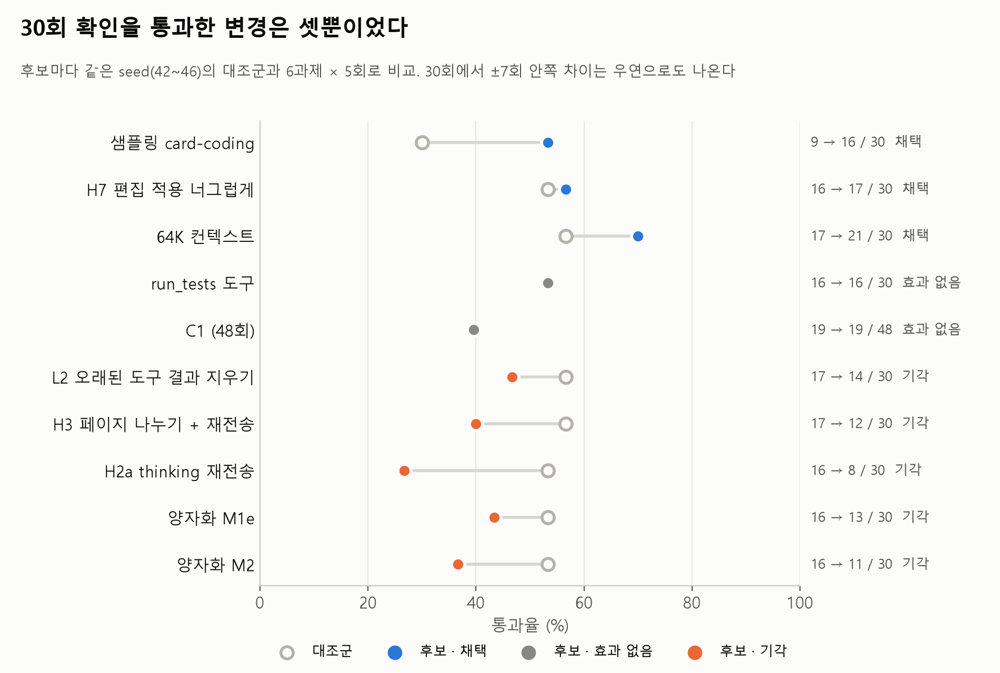
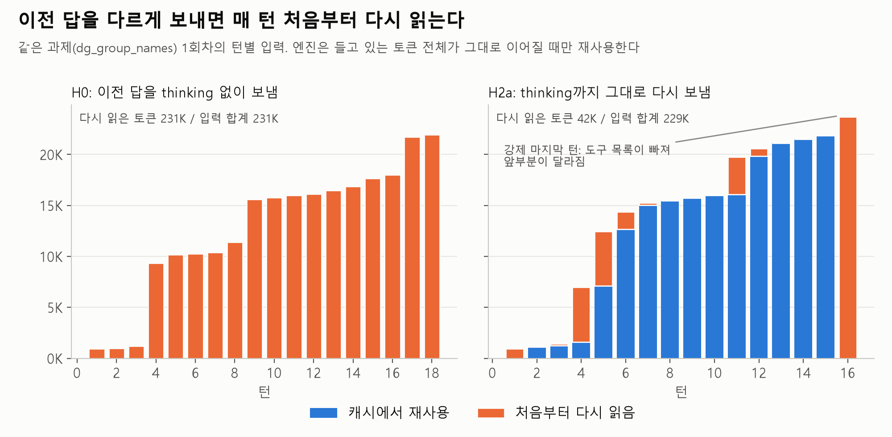
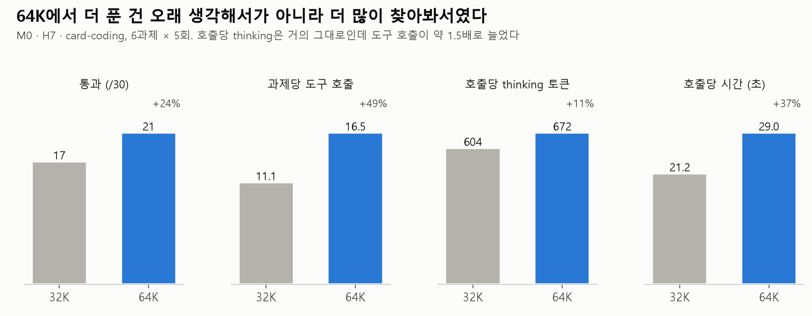
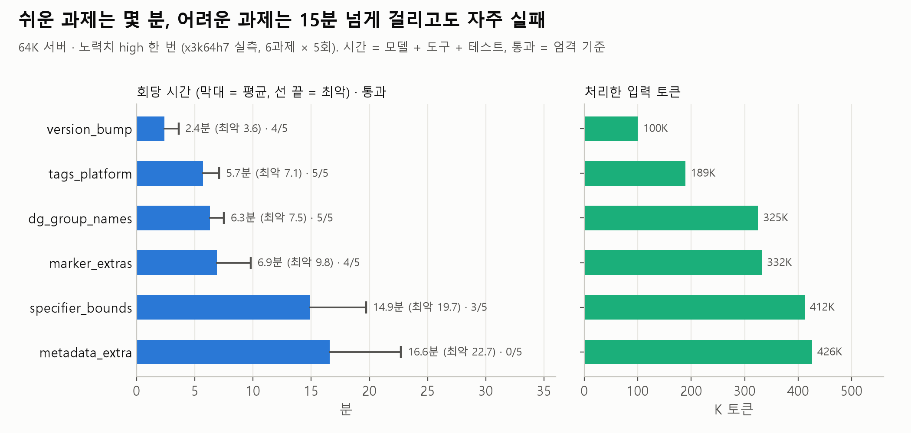
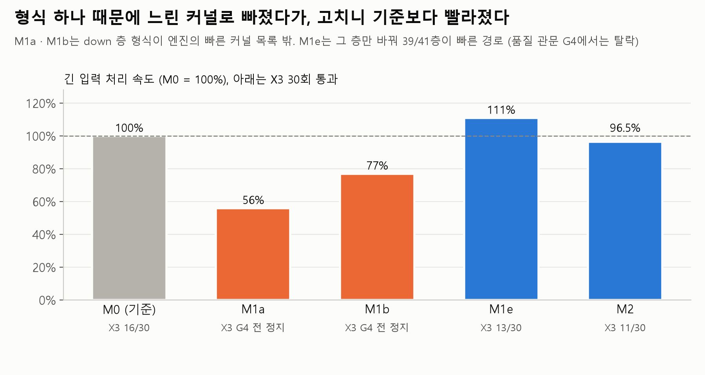

# 진행 요약 (2026-11-22)

11-18 ~ 11-22 의 실험을 한 장으로 모은다. 수치는 모두 `experiments/LEDGER.tsv` 에서 왔고, 결정과 근거는 `STATE.md`, 실험별 상세는 `docs/` 의 해당 문서에 있다.
그림은 `reports/figures/plots.py` 로 다시 그릴 수 있다.

## 고정한 것

| 항목 | 값 |
| --- | --- |
| 장비 | RTX 5070 Ti 16GB (sm_120, 70 SM) · RAM 32GB, 노트북에서 Tailscale · ssh 로 운영 |
| 모델 M0 | Qwen3.6-35B-A3B `UD-Q4_K_XL` (22.9GB). 40층 = attention 10 + Gated DeltaNet 30, expert 일부는 RAM |
| 엔진 E0 | STRATA v0.2.15 `c775728` 소스 빌드, q36 native 경로 |
| 평가 X3 | 실제 라이브러리(packaging) 버그 수정 6과제 × 5회(seed 42~46) = 30회, 비공개 테스트로 채점 |
| 판정 | 같은 seed 의 대조군과 짝 비교. 정확도 우선: 대조 대비 −1 이내면 '해 없음', 효과는 미리 정한 문턱 이상일 때만 |

## 기준 조합의 변화

| 날짜 | 기준 | X3 통과 | 바뀐 이유 |
| --- | --- | --- | --- |
| 11-18 | H0 (navigate + edit_file) | — | 읽기 도구만 준 v1 이 0/5 (모델이 없는 도구를 지어냄, T-011) |
| 11-20 | H0 + card-coding 샘플링 | 16/30 | card-general 9/30 대비 |
| 11-21 | H7 = H0 + 편집 적용 너그럽게 | 17/30 | 버려지던 편집 살리기, 손실 없음 |
| 11-22 | 64K 를 노력치 high 로 | 21/30 | 막는 것이 문맥이 아니라 호출 수였다 |
| 11-22 | 서버 64K 하나 + high 기본 (확정) | 21/30 | medium(64K) 13/30 · xhigh 20/30 은 기준 미달 |

## 30회 확인 결과

채택은 셋뿐이다. 15회 · 9회 탐색에서 좋아 보였던 후보(H1 · H2a · C1)는 30회에서 같거나 나빴다(C-012 · C-021). 30회에서도 ±7회 안쪽은 우연으로 나올 수 있어서, 효과 판정은 짝 비교와 미리 정한 문턱으로만 한다(C-016).

## 캐시: 매 턴 처음부터 다시 읽는다

q36 엔진은 들고 있는 토큰 전체가 새 프롬프트의 앞부분과 같을 때만 재사용한다. 하네스는 이전 답을 thinking 없이 보내므로 재사용이 0 이 된다(T-013).
thinking 까지 다시 보내면(H2a) 재읽기는 −83% 지만 정확도가 16 → 8 로 떨어져 기각했다. 그래서 엔진 쪽 패치(E1, 턴 체크포인트)로 간다 — `docs/e1-turn-ckpt-plan-20261122.md`. 모델 시간의 37~43% 가 프롬프트 읽기다.

## 32K vs 64K

64K 에서 더 푼 이유는 호출당 생각 길이(+11%)가 아니라 도구 호출 수(+49%)였다. 강제 마지막 턴이 늦게 오니 더 찾아보고 더 고쳤다. 대가는 시간(회차당 약 2.2배)이라 64K 는 기본이 아니라 '노력치 high' 로 둔다.

## 노력치 측정 (11-22)

64K 서버에서 노력치 두 팔을 30회씩 재고, 같은 seed 의 기존 결과와 짝 비교했다. 통과는 엄격한 'pass' 만 센다(C-024).

| 팔 | 노력치 (강제 턴 문턱 · 호출 상한) | 통과 | 대조 | 짝 | 회차당 | 판정 |
| --- | --- | ---: | --- | ---: | ---: | --- |
| `x3e64m` | medium (22,272 · 20) | 13/30 | 32K `x3h7` 17/30 | 2 : 6 | 약 21분 | 문턱 16 미달 → '64K 서버 하나 + medium' 기각 |
| `x3exh` | xhigh (55,296 · 30) | 20/30 | high `x3k64h7` 21/30 | 3 : 4 | 약 89분 | 문턱 22 미달 → xhigh 를 두지 않음 |

- xhigh 는 호출을 30번까지 허용해도 어려운 두 과제를 더 풀지 못했다(specifier 2/5 vs 3/5, metadata 0/5 vs 0/5). 시간만 1.7배.
- medium 은 64K 서버에서 32K 와 같은 문턱 · 상한인데 13/30 이었다. 짝 2 : 6 이라 우연만으로 보긴 어렵지만 원인은 확인하지 않았다.

실패하면 처음부터 다시 도는 운영을 같은 과제 · 같은 회차의 실측으로 추정하면 이렇다(서버 없이 계산, 모델 + 도구 + 테스트 시간).

| 운영 | 최종 통과 | 회당 평균 |
| --- | ---: | ---: |
| 64K 서버, high 한 번 | 21/30 | 8.8분 |
| 64K 서버, medium → high | 22/30 | 10.3분 |
| 32K 서버 → 실패하면 64K high (서버 재기동) | 23/30 | 9.9분 + 재기동 |
| 위에 xhigh 한 단계 더 | 24/30 | 17.5분 |

통과 1~2회 차이는 30회에서 우연으로 나올 수 있는 범위다. 그래서 **서버는 64K 하나, 기본 노력치 high** 로 두는 쪽이 가장 단순하고 빠르다(워커 기본값도 이것으로 바꿈, 11-22 사용자 확정).

## 실사용 체감 시간 추정

권장 운영(64K 서버, 노력치 high 한 번)의 과제별 실측이다(`x3k64h7`, 모델 + 도구 + 테스트 시간, 엄격 통과). 전체 평균 약 9분, 30회 중 21회 성공.
쉬운 네 과제는 10분 안쪽에 대부분 풀린다. 어려운 두 과제(specifier · metadata)가 시간의 대부분을 쓰고, metadata 는 아직 한 번도 풀지 못했다.
처음 추정은 'pass' 로 시작하는 결과를 모두 통과로 세서 metadata 를 약 2.5/5 로 잡았다. 엄격하게 세면 0/5 다(C-024).

## 맞춤 양자화 Q1

M1a · M1b 는 품질 관문(KL)은 통과했지만, down 층 형식이 엔진의 빠른 커널 목록 밖이라 전 층이 느린 경로로 빠졌다. 그 층만 바꾼 M1e 는 기준보다 빨랐지만 X3 13/30 으로 탈락, 더 완만한 M2 도 11/30 으로 탈락 → M0 유지(`docs/q1-plan-20261120.md`, `docs/engine-kernels-20261121.md`).

## 다음

1. E1 턴 체크포인트: 빌드 → V1(켜고 끈 출력 비교) → V2(엔진 검사) → V3 · V4(X3 30회)
2. 도구 T1(편집 직후 문법 검사) · T2(파일 개요 · 심볼 읽기) 30회
3. 새 과제 세트(Y) — 지금 6과제에 맞춰 고른 설정이 과적합인지 확인
4. 노트북 클라이언트(Claude Code · Codex)로 실제 흐름 확인(X4)
